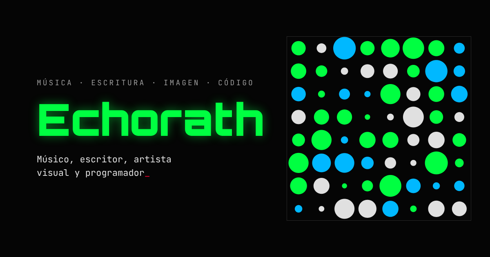

  

  Me interesa lo que ocurre cuando un patrón se repite con pequeños cambios hasta volverse otra cosa. 
  Lo busco en el sonido, en la palabra, en la imagen y en el código.

  <a href="https://damdavidprieto.github.io/Echorath/"><b>Ver el portafolio →</b></a>

---

## La obra

- **Música.** Pistas para escuchar en la propia web.
- **Escritura.** Ensayos, cuentos y notas.
- **Imágenes.** Serie generativa «Repetición» · 2024.
- **Algoritmos.** El código detrás de la obra: cada algoritmo se dibuja en directo, junto a su pseudocódigo y su código.
- **Efectos.** Nueve distorsiones para una misma imagen.

La obra se publica poco a poco, a medida que cada pieza está lista. Lo que aún no aparece en el portafolio está en preparación.

## Cómo está hecho

La web también es parte de la obra: su diseño, su generador y su framework visual, [Echorath UI](framework/), son propios, y su código está abierto en este repositorio. Cómo se añade una obra, se prueba y se publica está en la [guía técnica](docs/desarrollo.md).

## Derechos

La música, los textos, las imágenes y los algoritmos son © Echorath, con todos los derechos reservados ([detalle](site/content/LICENSE.md)). El código de la web y del framework es libre, con licencia [MIT](LICENSE).
