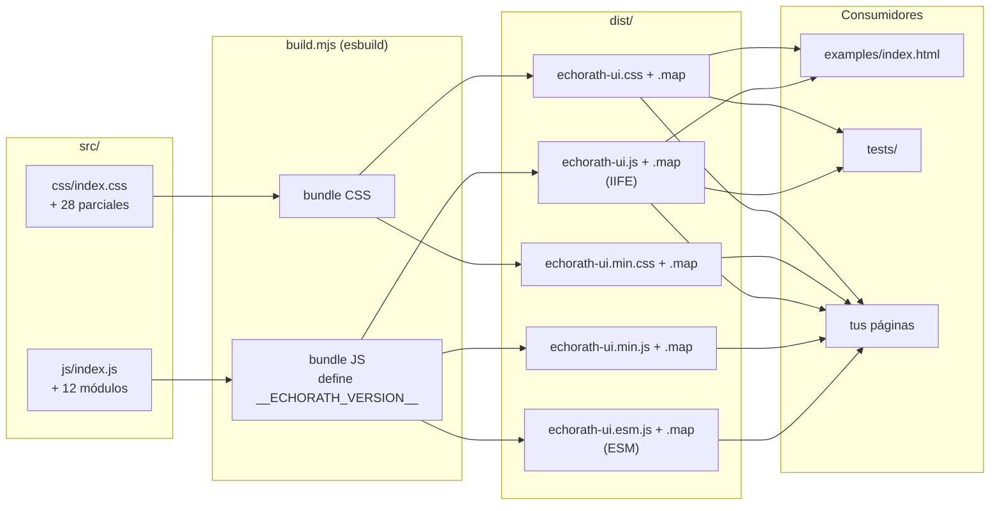
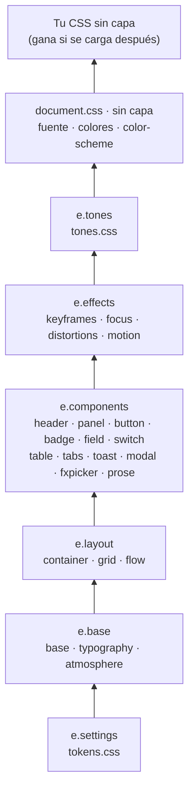
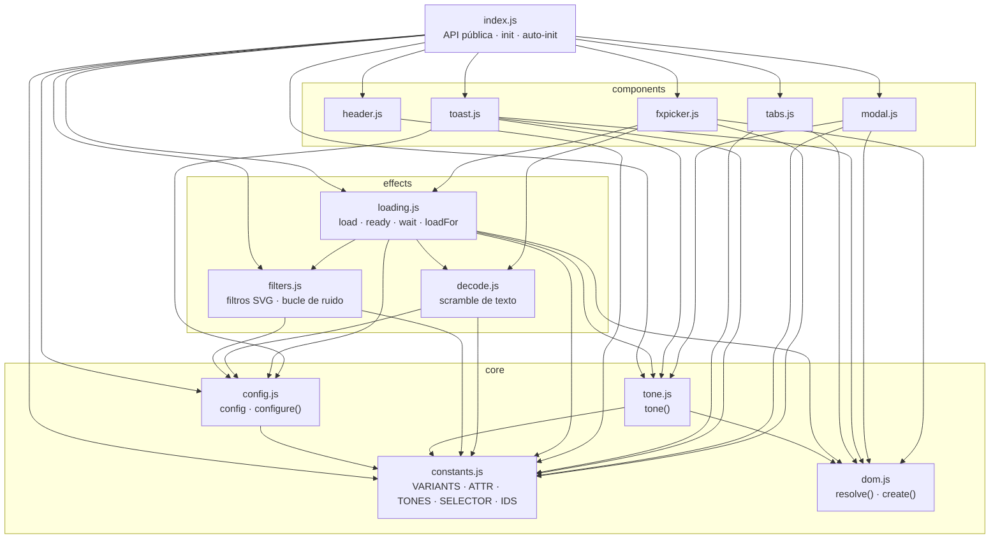
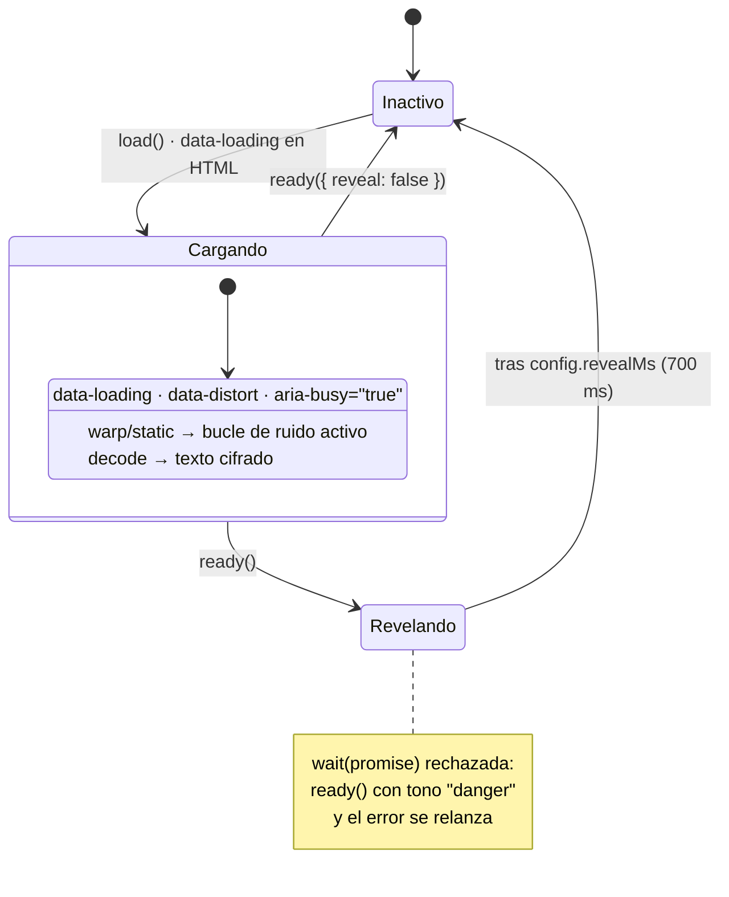

# Mapas de Echorath UI

Mapas para orientarse en el código: qué hay en cada carpeta, cómo se compila, en qué orden se aplica el CSS, qué módulo depende de cuál, cómo funciona el estado de carga y qué atributos, tokens y componentes existen.

Los diagramas usan Mermaid; GitHub los muestra como gráficos.

---

## 1. Mapa del repositorio

```text
framework/
├── package.json            Versión, scripts (build, watch, test) y dependencias fijas
├── build.mjs               Build con esbuild: genera dist/ y sus source maps
├── README.md               Introducción y uso rápido
├── CHANGELOG.md            Historial de versiones (SemVer)
├── .editorconfig           Formato común del editor
│
├── src/                    Código fuente: aquí se trabaja
│   ├── css/
│   │   ├── index.css       Punto de entrada: importa todo en orden de capas
│   │   ├── settings/       layers.css (orden de capas), tokens.css (variables)
│   │   ├── base/           fonts.css, document.css (sin capa), base.css, typography.css, atmosphere.css, print.css
│   │   ├── layout/         container.css, grid.css, flow.css
│   │   ├── components/     un archivo por componente (15)
│   │   ├── effects/        keyframes.css, focus.css, distortions.css, motion.css
│   │   └── themes/         tones.css (presets de data-tone)
│   ├── js/
│   │   ├── index.js        Punto de entrada: API pública y auto-init
│   │   ├── core/           constants, config, dom, tone
│   │   ├── effects/        filters (SVG), decode, loading (ciclo de carga), visibility (pausa fuera de pantalla)
│   │   └── components/     header, tabs, toast, modal, fxpicker
│   └── fonts/              Orbitron, JetBrains Mono y Literata (woff2, latino y latino extendido) y sus licencias OFL
│
├── dist/                   Generado por el build. No se edita a mano
│   ├── echorath-ui.css(.map)        CSS legible
│   ├── echorath-ui.min.css(.map)    CSS minificado
│   ├── echorath-ui.js(.map)         JS IIFE → window.EchorathUI
│   ├── echorath-ui.min.js(.map)     JS IIFE minificado
│   ├── echorath-ui.esm.js(.map)     JS módulo ES
│   └── fonts/                    las fuentes y sus licencias, copiadas por el build
│
├── types/echorath-ui.d.ts     Tipos para TypeScript y autocompletado
├── examples/index.html     Catálogo visual: componentes, distorsiones, laboratorio de efectos y foco
├── tests/
│   ├── smoke.test.mjs      Build, API, componentes, accesibilidad
│   ├── effects.test.mjs    Cada variante × cada tipo de componente, y su comportamiento
│   ├── fxpicker.test.mjs   Selector de efectos
│   └── fixtures/effects.html  Banco de pruebas de efectos
└── docs/                   MAP.md (este archivo), REFERENCE.md, CONVENTIONS.md
```

---

## 2. Pipeline de build



La versión del banner y de `EchorathUI.version` sale de `package.json`. Cada archivo de `dist/` termina con un comentario `sourceMappingURL`, y cada `.map` incluye el código original (`sourcesContent`), así que funciona aunque `src/` no esté publicado.

---

## 3. Mapa de capas CSS

Las capas se declaran una vez en `settings/layers.css`. Una capa posterior gana a una anterior **sin importar la especificidad** del selector. Los estilos de tu proyecto escritos fuera de una capa ganan a todas.

La única excepción dentro del framework es `base/document.css` (fuente y su tamaño base, colores y `color-scheme` de la página), que va **sin capa**. Así, el reset de un host o de otra librería, que suele ir sin capa, no puede anularlo: la regla que se carga después gana.



Por qué este orden:

- **tones al final:** `data-tone` debe ganar al tono por defecto de un componente (`.e-btn`, `.e-btn--danger`).
- **effects después de components:** una distorsión de carga cambia `transform`, `clip-path` o `filter` de cualquier componente.
- **motion dentro de effects con `!important`:** con movimiento reducido, las animaciones se paran aunque otra regla las active.

---

## 4. Mapa de módulos JS



Reglas: `core/` no importa nada de `effects/` ni de `components/`; `components/` no se importan entre sí (un componente puede usar `effects/`, como `fxpicker`). Solo `index.js` define la API pública.

---

## 5. Ciclo de vida de la carga



| Función | Hace |
|---|---|
| `load(el, { variant })` | Entra en carga. La variante sale de `opts.variant`, luego `data-distort`, luego `config.defaultVariant` |
| `ready(el, { reveal, tone })` | Sale de carga, para ruido y decode, aplica tono y revela |
| `wait(el, promise, opts)` | `load` mientras la promesa está pendiente, `ready` al terminar |
| `loadFor(el, ms, opts)` | `wait` con un temporizador |

---

## 6. Mapa de atributos

| Atributo | Lo pone | Valores | Efecto |
|---|---|---|---|
| `data-tone` | Autor o `tone()` | `ok` `info` `warn` `danger` `sys` `off` | Define `--e-tone` en el elemento y sus hijos |
| `data-distort` | Autor o `load()` | ver variantes | Elige la distorsión de carga |
| `data-loading` | Autor o `load()` | presencia | Activa la distorsión. En HTML, `init()` lo registra |
| `data-focus` | Autor | `glitch` `sweep` | Cambia el efecto de foco (por defecto, brillo) |
| `data-tabs` | Autor | presencia | Marca un grupo de pestañas |
| `data-tab-target` | Autor | selector | Panel que muestra la pestaña |
| `data-e-manual` | Autor, en `<html>` | presencia | Desactiva el auto-init |
| `data-close-label` | Autor, en `.e-header__toggle` | texto | Texto del botón con el menú abierto (por defecto "Cerrar") |
| `data-e-interactive` | Autor | presencia | El control sigue aceptando clics dentro de un elemento en carga |
| `data-e-pause-on-hover` | Autor, junto a `data-loading` | presencia | La distorsión se detiene con el puntero encima o el foco de teclado dentro; el elemento acepta el puntero |
| `data-reveal` | Runtime | presencia | Animación de salida de la carga |
| `data-decoding` | Runtime | presencia | Texto cifrándose (decode) |
| `data-boxed` | Runtime | presencia | Un elemento `inline` pasa a `inline-block` mientras se distorsiona, para que `transform` funcione |
| `aria-busy` | Runtime | `true` | Accesibilidad durante la carga |

| Clase de estado | Lo pone | En |
|---|---|---|
| `is-visible` | Runtime | `.e-toast` |
| `is-open` | Runtime | `.e-modal-overlay`, `.e-header__nav` |
| `is-compact` | Runtime | `.e-header`, cuando la marca y la navegación no caben en una fila |
| `is-entering` | Runtime | `.e-tabpanel` |
| `is-scroll-locked` | Runtime | `<html>`, mientras hay un modal abierto |

| Variable que escribe el runtime | En | Valor |
|---|---|---|
| `--e-header-offset` | `<html>` | Altura actual de `.e-header`; la usa `scroll-padding-top` |

---

## 7. Mapa de tokens

Todos en `src/css/settings/tokens.css`, dentro de `:root`. Se pueden redefinir en `:root` o en un contenedor.

| Categoría | Tokens |
|---|---|
| Superficies | `--e-color-bg` `--e-color-surface` `--e-color-sunken` `--e-color-line` `--e-color-line-soft` · `--e-color-line-strong` (borde que marca un control, 3,9:1) |
| Texto | `--e-color-text` `--e-color-text-dim` `--e-color-text-faint` `--e-color-on-signal` |
| Señal (neón) | `--e-color-green` `--e-color-blue` `--e-color-red` `--e-color-amber` `--e-color-cyan` |
| Atmósfera | `--e-color-grid` `--e-color-overlay` `--e-color-glass` |
| Tipografía | `--e-font-display` `--e-font-mono` `--e-font-text` (lectura) · `--e-font-size-2xs` … `--e-font-size-2xl` · `--e-tracking-tight` `-wide` `-wider` |
| Espaciado | `--e-space-1` (4px) `-2` `-3` `-4` `-5` `-6` `-8` `-10` (40px) |
| Layout | `--e-container-max` (1200px) `--e-gutter` (16–32px) `--e-header-offset` (lo actualiza el runtime) |
| Forma | `--e-border-width` `--e-corner-size` `--e-corner-size-active` `--e-control-height` |
| Brillo | `--e-glow-sm` `--e-glow-md` `--e-glow-lg` |
| Movimiento | `--e-ease` `--e-ease-spring` `--e-duration-fast` `-base` `-slow` |
| Distorsión | `--e-distort-split` `--e-distort-a` `--e-distort-b` |
| Capas z | `--e-z-sticky` `--e-z-header` `--e-z-crt` `--e-z-toast` `--e-z-modal` |
| Por elemento | `--e-tone` (no está en `:root`; lo ponen `data-tone` y algunos componentes) |

---

## 8. Mapa de componentes

| Componente | Archivo | Bloque | Elementos | Modificadores | Estados | Tono por defecto |
|---|---|---|---|---|---|---|
| Header | `header.css` + `header.js` | `.e-header` | `__sub` `__toggle` `__nav` | `--sticky` | `__nav.is-open` · `.is-compact` (menú plegado cuando la navegación no cabe; siempre por debajo de 640px) · publica `--e-header-offset` | verde (fijo) |
| Container | `container.css` | `.e-container` | | | | |
| Panel | `panel.css` | `.e-panel` | `__head` `__title` | | `:hover` `:focus-within` | borde línea, esquinas verde |
| Button | `button.css` | `.e-btn` | | `--ghost` `--solid` `--danger` `--warn` `--info` `--block` `--sm` | `:hover` `:focus-visible` `:disabled` | verde |
| Badge | `badge.css` | `.e-badge` `.e-dot` | | | | verde |
| Field | `field.css` | `.e-field` `.e-input` | | | `:focus-visible` `[aria-invalid]` | azul |
| Switch | `switch.css` | `.e-switch` | `__track` | | `:checked` `:focus-visible` | ámbar (fijo) |
| Table | `table.css` | `.e-table` | `.e-empty` (fila) | | `tr:hover` | texto |
| Tabs | `tabs.css` | `.e-tabs` `.e-tab` `.e-tabpanel` | | | `[aria-selected]` `[hidden]` `.is-entering` | verde |
| Toast | `toast.css` | `.e-toasts` `.e-toast` | `__title` `__msg` | | `.is-visible` | azul |
| Effect picker | `fxpicker.css` + `fxpicker.js` | `.e-fx` | `__toggle` `__list` `__option` | | `__toggle[aria-expanded]` · `__option[aria-pressed]` con barra de tiempo | verde |
| Modal | `modal.css` + `modal.js` | `.e-modal-overlay` `.e-modal` | `__head` `__close` `__body` `__foot` | `--lg` | `.is-open` · `html.is-scroll-locked` · `modal()` devuelve un control: `setTitle` `setBody` `close` | verde |
| Prose | `prose.css` | `.e-prose` | `__meta` | | `--e-prose-size` `--e-prose-measure` | texto; enlaces y citas en azul |

Todos aceptan `data-loading` + `data-distort`. `decode` solo vale para elementos que contienen únicamente texto.

---

## 9. Cómo usar los source maps

1. Carga `dist/echorath-ui.css` y `dist/echorath-ui.js` (o las versiones `.min`) en tu página.
2. Abre las herramientas de desarrollo del navegador. Con los mapas activados (es lo habitual):
   - **Elementos → Estilos:** cada regla muestra su archivo original, por ejemplo `components/button.css:42`.
   - **Fuentes:** aparece el árbol `src/js/...`, y los puntos de interrupción se ponen en el código original aunque cargues el `.min.js`.
   - **Consola:** los errores apuntan a la línea de `src/`.
3. Para cambiar algo, edita `src/` y ejecuta `npm run watch`. El build se repite en cada guardado y basta con recargar la página.
